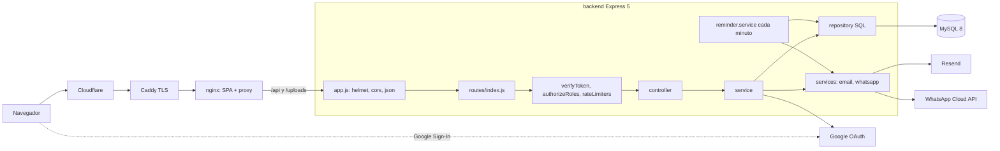

# Arquitectura de Dentissa

## Resumen
Monorepo de dos paquetes npm independientes, sin workspaces. `backend/` es un monolito modular en
Express 5 (CommonJS), organizado por dominio y con capas routes → controller → service →
repository sobre MySQL con SQL manual. `frontend/` es una SPA en React 19 con Vite, organizada por
tipo de archivo. En producción, nginx sirve la SPA y hace de proxy hacia la API, lo que deja a
ambos en el mismo origen.

## Diagrama de componentes

## Módulos
| Módulo | Ruta | Responsabilidad | Depende de |
|---|---|---|---|
| auth | `backend/src/modules/auth` | Registro, login, Google, contraseñas | pacientes.repository, email |
| users | `backend/src/modules/users` | CRUD de usuarios y personal | utils |
| citas | `backend/src/modules/citas` | Citas de paciente y personal | servicios.repository, pacientes.repository, whatsapp |
| pacientes | `backend/src/modules/pacientes` | Perfil del paciente | — |
| historial | `backend/src/modules/historial` | Historial clínico y alta de pacientes | db |
| reportes | `backend/src/modules/reportes` | Reportes y exportación Excel/PDF | exceljs, pdfkit |
| dashboard | `backend/src/modules/dashboard` | Resumen del panel | — |
| servicios | `backend/src/modules/servicios` | Catálogo de servicios | utils/upload |
| promocion | `backend/src/modules/promocion` | Promociones | utils/upload |
| images | `backend/src/modules/images` | Galería | utils/upload |
| comentarios | `backend/src/modules/comentarios` | Reseñas y moderación | citas.repository |
| faqs | `backend/src/modules/faqs` | Preguntas frecuentes | — |
| Transversal | `backend/src/{config,middlewares,utils,services}` | Pool, auth, errores, correo, WhatsApp, cron | — |
| SPA | `frontend/src` | Sitio público, panel y portal del paciente | API `/api/v1` |

## Flujo principal
Un paciente agenda una cita: `InicioPaciente` llama a `services/api.js`, que envía el JWT de
`localStorage` a `POST /api/v1/citas/paciente`. Pasa por nginx y `verifyToken`; `citas.controller`
delega en `citas.service`, que valida fecha y traslapes por duración del servicio, y
`citas.repository` inserta con SQL parametrizado. Después se intenta la confirmación por WhatsApp
sin afectar la respuesta. Los errores llegan a `errorHandler` como `AppError`.

## Datos
MySQL 8 con `mysql2/promise` y pool único (`config/db.js`), sin ORM; transacciones manuales en
`auth` e `historial`. **El esquema no está versionado:** se crea y cambia directamente en MySQL
(confirmado por el usuario, 2026-11-08) y `*.sql` está en `.gitignore`. Tablas observadas: `usuarios`,
`roles`, `paciente`, `citas`, `servicio`, `h_clinico`, `promocion`, `comentarios`, `pregunta`,
`imagenes`, `restablecimiento_contrasenas`. Imágenes en disco (`uploads/`, bind mount).
Los campos completos son inferidos de las consultas.

## Integraciones externas
- **Google Sign-In:** `@react-oauth/google` en el cliente; `verifyIdToken` en el servidor.
- **WhatsApp Cloud API** (Graph v25.0): apagada en producción con `WHATSAPP_ENABLED=false` porque
  no se paga plan de mensajería (confirmado por el usuario, 2026-11-08).
- **Resend:** correo transaccional.
- **Cloudflare:** delante del sitio (cabecera `Server: cloudflare`, 2026-11-08).
- Google Fonts e imágenes de Unsplash cargadas desde el navegador.

## Frontend
- Componentes y organización: `src/{pages,components,services,api,hooks,utils,data,styles}`;
  páginas separadas por rol en `pages/admin` y `pages/paciente`.
- Estado: local con hooks; sin Context, Redux ni Zustand.
- Routing: `BrowserRouter`, con `React.lazy` en las públicas; guarda `PrivateRoute` en `App.jsx`.
- Design tokens / sistema de diseño: [design/system.md](design/system.md).
- Accesibilidad: objetivo WCAG 2.1 AA (constitución P16).

## Backend
- Contratos de API: TODO(init): no hay OpenAPI; el contrato es implícito en `routes/` y `normalize.js`.
- Autenticación y autorización: JWT HS256 en `Authorization: Bearer`; `verifyToken` consulta el
  usuario en cada petición; `authorizeRoles` aplica el rol. Roles: Administrador, Asistente, Paciente.
- Observabilidad: solo `console.*`; ver [observability.md](observability.md).
- Seguridad: ver [security.md](security.md).

## Contrato entre capas
- Fuente de verdad: no hay esquema ni tipos compartidos. REST/JSON bajo `/api/v1`, con respuestas
  `{success, message, payload}` adaptadas en `frontend/src/api/normalize.js`.
- Versionado: prefijo `/api/v1`.
- Cómo se regenera: no aplica.

## Despliegue
Docker Compose en el servidor, con build en sitio, disparado a mano. Sin CI de despliegue ni
staging. Detalle en [deployment.md](deployment.md).

## Evidencia (solo si status=inferred)
| Afirmación | Archivos | Confianza |
|---|---|---|
| Capas por módulo | `backend/src/modules/*`, `backend/src/routes/index.js` | alta |
| SQL manual sin esquema versionado | `backend/src/modules/*/*.repository.js`, `backend/.gitignore` | alta |
| SPA con proxy nginx | `frontend/src/App.jsx`, `frontend/nginx.conf` | alta |
| Cloudflare y Caddy delante | respuesta de producción, `backend/Caddyfile` | alta |

## Deuda técnica y riesgos observados
- Módulos que importan el repository de otro (`citas.service` → `servicios.repository`).
- Sin tests ni linter en el backend; 15 problemas de lint previos en el frontend.
- `backend/src/middlewares/errorHandler.js` tiene funciones duplicadas y anidadas: funciona, pero
  reasigna `module.exports` al manejar un error.
- Validación manual dispersa en services.
- El cron de recordatorios vive en el proceso web.
- Volumen `uploads` declarado y sin usar en `docker-compose.prod.yml`.
- Código muerto: `components/PrivateRoute.jsx`, `sidebarpaciente.jsx`, `ModalAgendarCita.jsx`.
- Roles escritos como texto literal y `ROL_PACIENTE = 3` fijo en `auth.service.js`.
