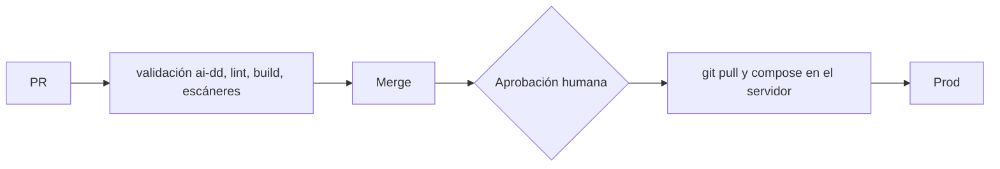

# Despliegue de Dentissa

> Regla innegociable: ningún deploy a producción sin aprobación humana explícita.

## Entornos
| Entorno | URL | Rama / disparador | Aprobación | Datos |
|---|---|---|---|---|
| dev | `localhost:5173` o `localhost:8080` | manual | ninguna | de desarrollo |
| prod | https://sistema.dentissa.app | manual en el servidor (confirmado por el usuario, 2026-11-08) | **humana** | reales |

No hay staging (confirmado por el usuario, 2026-11-08).

## Plataforma e infraestructura
Docker Compose en un servidor propio: `frontend` (nginx), `backend` (`Dockerfile.prod`, Node 22,
usuario no root), `db` (MySQL 8, sin puertos publicados) y `caddy` (perfil opcional, TLS).
Delante responde Cloudflare (`Server: cloudflare`, comprobado el 2026-11-08). Dominio en Caddy:
`sistema.dentissa.app` (confirmado por el usuario, 2026-11-08). No hay IaC.

TODO(init): confirmar el proveedor del servidor y si Cloudflare llega por túnel o por proxy DNS.

## Pipeline

`.github/workflows/ai-dd.yml` valida los PR. No despliega: el despliegue sigue siendo manual.

## Cómo desplegar
```bash
# En el servidor, desde backend/ (inferido del compose; TODO(init): confirmar los pasos reales)
git pull
docker compose -f docker-compose.prod.yml --profile caddy up -d --build
```

## Migraciones de base de datos
- Cuándo se aplican: a mano en MySQL, según se necesita (confirmado por el usuario, 2026-11-08).
- Patrón: expand → migrate → contract (compatibles con la versión anterior); exigido al código nuevo (P7).
- Comando: no existe; ver RD1.

## Rollback
1. En el servidor, volver al commit anterior con `git checkout <commit>` o `git revert` (confirmado por el usuario, 2026-11-08).
2. Reconstruir con `docker compose -f docker-compose.prod.yml --profile caddy up -d --build`.
- Tiempo estimado: TODO(init): medirlo; depende del build en el servidor.
- Si hubo migración: restaurar desde el respaldo manual más reciente; no hay reversión de esquema. Ver RD1 y RD3.

## Hotfix
- Rama: TODO(init): confirmar; propuesta `hotfix/<slug>` desde el commit desplegado.
- Staging: no, directo con la misma aprobación humana, porque no hay staging.
- Vuelta a la rama principal: merge de la rama hotfix a `main` tras producción.

## Variables de entorno
| Nombre | dev | prod | Dónde se configura |
|---|---|---|---|
| `DB_HOST`, `DB_PORT`, `DB_USER`, `DB_PASSWORD`, `DB_NAME` | ✓ | ✓ | `backend/.env`, `.env.prod` |
| `DB_ROOT_PASSWORD` | — | ✓ | compose |
| `PORT`, `NODE_ENV`, `FRONTEND_URL`, `APP_URL` | ✓ | ✓ | `.env`, `.env.prod` |
| `TRUST_PROXY` | ✓ | ✓ | `.env.prod`; ver RS4 |
| `JWT_SECRET`, `JWT_EXPIRES_IN`, `PASSWORD_MIN_LENGTH` | ✓ | ✓ | `.env`, `.env.prod` |
| `GOOGLE_CLIENT_ID` | ✓ | ✓ | `.env`, build del frontend |
| `RESEND_API_KEY`, `EMAIL_REMITENTE` | ✓ | ✓ | `.env`, `.env.prod` |
| `WHATSAPP_ENABLED`, `WHATSAPP_TOKEN`, `WHATSAPP_PHONE_NUMBER_ID` | ✓ | ✓ | `.env`, `.env.prod` |
| `DOMAIN`, `PUBLIC_PORT` | — | ✓ | compose |
| `VITE_API_URL`, `VITE_ASSETS_URL`, `VITE_GOOGLE_CLIENT_ID` | ✓ | ✓ | build del frontend |

(Solo nombres. Nunca valores.)

Valores no secretos confirmados por el usuario (2026-11-08): `NODE_ENV=production` y
`WHATSAPP_ENABLED=false` en producción; `TRUST_PROXY=1`.

## Verificación post-deploy
- Health check: `GET /health` (no comprueba MySQL; ver RD5).
- Smoke tests: portada, login, y que `/api/v1/servicios/publicos` responda.
- Logs: `docker compose logs` · Métricas: no hay · Alertas: no hay (ver [observability.md](observability.md)).
- Trazabilidad: cuando exista `X-Request-Id` (OB3), buscar por `request_id` una petición de los
  smoke tests y confirmar que sus logs y eventos de auditoría llegan al destino esperado.

## Riesgos conocidos

### RD1 · Alta — Esquema de base de datos sin versionar
El esquema vive solo en MySQL y se cambia a mano; un `ALTER TABLE` está documentado dentro de
`comen.repository.js:10`. No se puede reconstruir la base ni revertir un cambio.
Correcciones:
- RD1.a Exportar a un archivo versionado el esquema actual, sin datos — estado: pendiente
- RD1.b Adoptar una herramienta de migraciones con ADR y ajustar la regla `*.sql` del `.gitignore` — estado: pendiente
- RD1.c Mover a migraciones los cambios documentados dentro de repositories — estado: pendiente

### RD2 · Alta — Respaldos solo manuales
Hay respaldos, pero se hacen a mano (confirmado por el usuario, 2026-11-08). Un olvido significa
perder expedientes clínicos.
Correcciones:
- RD2.a Programar `mysqldump` diario y copia de `uploads/` — estado: pendiente
- RD2.b Guardar las copias cifradas fuera del servidor — estado: pendiente
- RD2.c Probar periódicamente la restauración y documentar el resultado — estado: pendiente

### RD3 · Media — Rollback sin versiones identificables
Las imágenes se construyen en el servidor, sin tags ni imágenes versionadas; el rollback depende
de reconstruir y falla si el build falla.
Correcciones:
- RD3.a Etiquetar cada release y anotar el commit desplegado — estado: pendiente
- RD3.b Conservar la imagen anterior para volver sin reconstruir — estado: pendiente

### RD4 · Media — Sin staging
Todo cambio se prueba por primera vez en producción con datos reales.
Correcciones:
- RD4.a Crear un entorno de staging con datos ficticios, o aceptar la excepción por escrito — estado: pendiente

### RD5 · Media — El health check no comprueba la base de datos
`GET /health` responde `ok` aunque MySQL esté caído (`backend/src/config/app.js`).
Correcciones:
- RD5.a Añadir una comprobación de conectividad con MySQL — estado: pendiente

### RD6 · Media — Cron de recordatorios dentro del proceso web
Con más de una réplica, los recordatorios se duplicarían (`reminder.service.js`).
Correcciones:
- RD6.a Añadir un bloqueo o separar el cron en su propio proceso antes de escalar — estado: pendiente

### RD7 · Baja — Variables de entorno sin documentar
No hay `.env.example` versionado, aunque `.gitignore` lo permite.
Correcciones:
- RD7.a Añadir `.env.example` en cada paquete, solo con nombres — estado: pendiente

### RD8 · Alta — Sin tests ni validación automática
No hay tests, y los cambios llegaban a producción sin validación automática.
Correcciones:
- RD8.a Adoptar un framework de tests en backend y frontend, con ADR — estado: en curso (spec 018)
- RD8.b Cubrir autenticación y citas con tests — estado: en curso (spec 018, solo autenticación; citas → spec 019)
- RD8.c Activar `.github/workflows/ai-dd.yml` y añadir tests y linter del backend — estado: en curso (spec 018)
